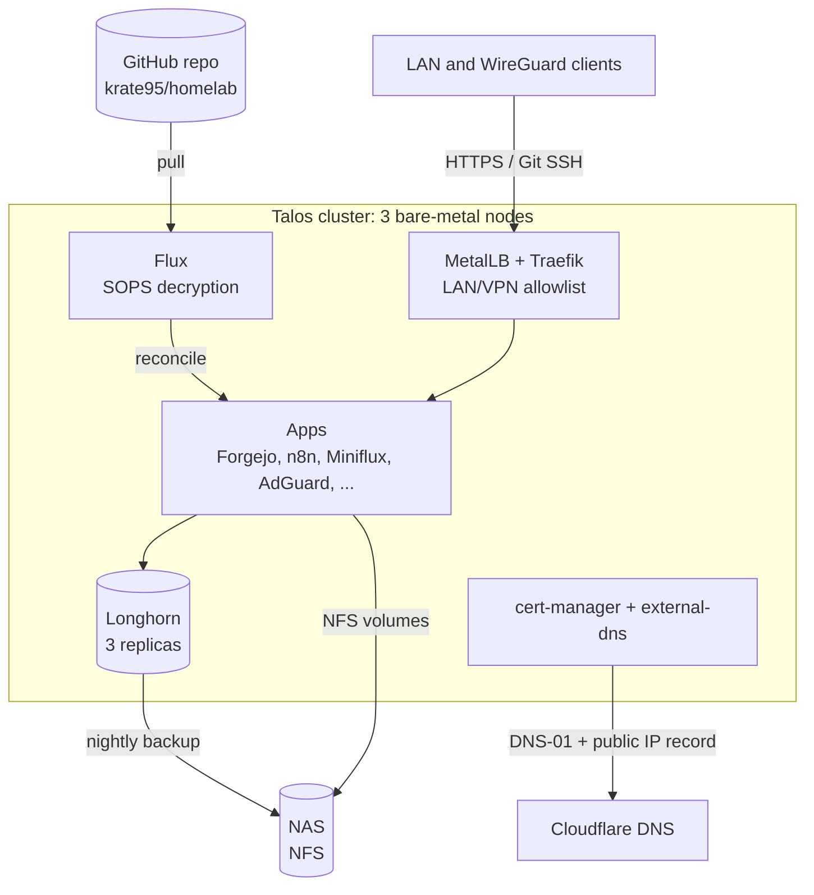

# homelab

A bare-metal Kubernetes cluster running [Talos Linux](https://www.talos.dev/), managed entirely through GitOps with [Flux](https://fluxcd.io/). Everything in the cluster, from storage and ingress to certificates and apps, is declared in this repository and reconciled automatically.


## Purpose

This homelab has two goals:

1. **Self-host the applications I use every day, privately.** My Git forge, RSS reader, automations, search engine, DNS and location history run on hardware I own and are only meant to be reached from my home network or VPN.
2. **Above all, learn to run a cluster the way it's done in production.** The point isn't just to get apps running, but to operate them with near-enterprise practices: everything declared in git and reconciled automatically, no manual changes on the nodes, encrypted secrets, a highly available control plane, replicated storage with off-cluster backups, automated certificates, and explicit decisions about scheduling, priorities and security.

This repository is the single source of truth for the cluster, and also a record of that learning. The commit history shows how it grew, and the [design decisions](#design-decisions) section explains the problems I hit along the way and how I solved them.

## Highlights

- **Immutable OS**: Talos on three bare-metal nodes. No SSH and no package manager; the nodes are configured only through the Talos API.
- **GitOps end to end**: Flux reconciles the cluster from `main`, and Kustomizations are ordered with `dependsOn` so CRDs exist before the resources that use them.
- **No secrets or network details in git**: secrets are encrypted with SOPS/age. The domain, ACME email, IP ranges and NFS paths are injected at reconcile time from an encrypted `cluster-vars` Secret.
- **Replicated storage with off-cluster backups**: Longhorn keeps 3 replicas of every volume and takes nightly backups to a NAS over NFS.
- **Automatic TLS and DNS**: cert-manager issues a wildcard Let's Encrypt certificate via Cloudflare DNS-01, and external-dns keeps the public record in sync with a dynamic home IP.
- **Private by default**: every ingress, HTTP and TCP, is restricted to the LAN and the WireGuard VPN through Traefik allowlists.

## Hardware

| Node | Machine | CPU | RAM | Role / tier |
|---|---|---|---|---|
| `dalinar` | Dell OptiPlex 3080 Micro | Intel Core i5-10500T (6C/12T) | 24 GB | control plane + workloads, `performance=high` |
| `kaladin` | Lenovo ThinkCentre M920q | Intel Core i5-8500T (6C/6T) | 16 GB | control plane + workloads, `performance=medium` |
| `shallan` | Dell Wyse 5070 | Intel Pentium Silver J5005 (4C/4T) | 8 GB | control plane + light workloads, `performance=low` |

All three nodes are control-plane nodes that also run workloads, so the cluster has an HA etcd quorum without dedicated masters. Outside the cluster:

- **NAS** (openmediavault): NFS storage for backups and bulk data.
- **Proxmox VE** host.

## Architecture



### Reconciliation order

Flux applies the cluster in layers. Each layer waits for the previous one to be healthy:

```
flux-system
└── cluster-vars            # encrypted Secret with domain, email, IP ranges, NFS paths
    └── infrastructure      # HelmReleases: Longhorn, MetalLB, Traefik, cert-manager, external-dns, NFS provisioner
        ├── metallb-config        # IPAddressPool, L2Advertisement
        ├── cert-manager-config   # ClusterIssuer (Let's Encrypt, Cloudflare DNS-01)
        ├── traefik-config        # wildcard Certificate, TLSStore, local-only middleware
        ├── longhorn-config       # backup target and recurring backup job
        └── external-dns-config   # CronJob that publishes the current public IP
            └── apps/*
```

The `*-config` layers are split out because they use CRDs installed by the Helm charts. If they were applied in the same batch as the charts, the dry-run would fail before the CRDs existed.

## Stack

### Platform

| Component | Purpose |
|---|---|
| [Talos Linux](https://www.talos.dev/) | Immutable, API-driven Kubernetes OS |
| [Flux](https://fluxcd.io/) | GitOps reconciliation, Helm releases, SOPS decryption |
| [SOPS](https://github.com/getsops/sops) + [age](https://github.com/FiloSottile/age) | Encrypted secrets committed to git |
| [MetalLB](https://metallb.io/) | `LoadBalancer` IPs on bare metal (L2 mode) |
| [Traefik](https://traefik.io/) | Ingress controller as a DaemonSet with `externalTrafficPolicy: Local` to preserve client IPs |
| [cert-manager](https://cert-manager.io/) | Wildcard TLS certificate from Let's Encrypt |
| [external-dns](https://github.com/kubernetes-sigs/external-dns) | Cloudflare DNS records managed from the cluster |
| [Longhorn](https://longhorn.io/) | Replicated block storage with scheduled NFS backups |
| [nfs-subdir-external-provisioner](https://github.com/kubernetes-sigs/nfs-subdir-external-provisioner) | Dynamic NFS volumes on the NAS |

### Applications

| App | What it does |
|---|---|
| [AdGuard Home](https://adguard.com/adguard-home.html) | Network-wide DNS and ad blocking, exposed on a dedicated MetalLB IP |
| [Forgejo](https://forgejo.org/) + runner | Self-hosted Git forge with CI (Docker-in-Docker runner); Git over SSH through a Traefik TCP entrypoint |
| [Homepage](https://gethomepage.dev/) | Dashboard with Kubernetes, Proxmox and openmediavault widgets |
| [n8n](https://n8n.io/) | Workflow automation, integrated with Miniflux |
| [Miniflux](https://miniflux.app/) | RSS reader |
| [SearXNG](https://docs.searxng.org/) | Private metasearch engine |
| [Dawarich](https://dawarich.app/) | Self-hosted location history, with PostGIS and a local Photon geocoder |
| [IT-Tools](https://it-tools.tech/) / [Omni-Tools](https://github.com/iib0011/omni-tools) | Developer utilities |
| [OpenSpeedTest](https://openspeedtest.com/) | LAN speed test |

## Design decisions

### Secrets and environment-specific values

`.sops.yaml` encrypts any file under a `secrets/` directory with an age key that only exists on my workstation and in the cluster. Values that aren't secret but still shouldn't be public (base domain, ACME email, LAN/WireGuard/pod CIDRs, MetalLB range, NFS server and paths) live in `clusters/roshar/secrets/cluster-vars.yaml`. Each Flux Kustomization pulls them in with `postBuild.substituteFrom`, so manifests reference `${BASE_DOMAIN}` or `${NFS_SERVER_IP}` instead of hard-coded values.

### Dynamic public IP without committing it

The home connection has a dynamic IP. Instead of a static `DNSEndpoint` in git, a CronJob checks the public IP every 5 minutes and applies the `DNSEndpoint` itself. external-dns then syncs it to Cloudflare. Its ServiceAccount can only touch `DNSEndpoint` resources, and can only modify the one named `wildcard`.

### Private ingress, public certificates

All services use a real public domain with a valid wildcard certificate, but every ingress goes through a `local-only` Traefik middleware that only allows the LAN, the WireGuard VPN subnet and the pod CIDR. Git over SSH, which uses a raw TCP route instead of HTTP, has an equivalent `MiddlewareTCP` allowlist. Traefik runs with `externalTrafficPolicy: Local` so it sees the real client IP and can enforce the allowlist.

### Storage tiers

- **Longhorn** (`longhorn-rwo-retain`): 3 replicas, `Retain` reclaim policy, best-effort data locality. It backs up every night at 02:00 to the NAS and keeps the last 3 backups.
- **NFS** for bulk data that doesn't need replication inside the cluster.
- **Static NFS volumes for Forgejo**: the NAS pools disks with mergerfs. On the mergerfs export, git's atomic renames (`config.lock` → `config`) failed with `ESTALE`, so Forgejo's repositories and LFS data were moved to static PersistentVolumes on a plain ext4 export.

### Scheduling on uneven hardware

The nodes are very different (from a thin client to a 6-core desktop), so they're labelled `homelab/performance=low|medium|high`. Workloads use preferred node affinity to land on a suitable tier. Lightweight platform services (MetalLB, cert-manager, external-dns, the NFS provisioner) and small tools prefer the thin client, databases and mid-sized apps prefer the M920q, and the heaviest workloads (Dawarich and its geocoder, SearXNG, the CI runner) prefer the i5-10500T. Three `PriorityClass`es (`homelab-critical`, `homelab-medium` by default, `homelab-low`) ensure DNS, ingress and storage survive resource pressure.

### Hardening

Workloads run with `allowPrivilegeEscalation: false`, seccomp profiles and non-root users where the image allows it (for example, Forgejo rootless and Dawarich rootless). Service account tokens are only mounted when an app needs the Kubernetes API.

## Repository layout

```
clusters/roshar/        # Flux entrypoint: sync config and layer definitions
  flux-system/          # Flux components (generated by flux bootstrap)
  secrets/              # cluster-vars (SOPS)
infrastructure/         # Platform components (HelmRepository + HelmRelease)
  <component>/
  <component>-config/   # Resources that depend on the component's CRDs
apps/                   # One directory per application
  <app>/secrets/        # App secrets (SOPS)
```

## Bootstrapping

```sh
# 1. Load the age key into the cluster so Flux can decrypt secrets
kubectl create namespace flux-system
kubectl -n flux-system create secret generic sops-age \
  --from-file=age.agekey=./age.agekey

# 2. Bootstrap Flux against this repository
flux bootstrap github \
  --owner=krate95 --repository=homelab \
  --branch=main --path=clusters/roshar --personal
```

Flux then installs everything else in dependency order.

## AI assistance

This repository was built with the help of AI tools. AI wrote the documentation (including this README), helped me troubleshoot problems along the way, and supported my decision-making by helping me research best practices and weigh trade-offs. I wrote the manifests myself, apart from small edits made by the AI, and I reviewed every change before it was committed.

## Roadmap

- [ ] Monitoring stack (Prometheus, Grafana, alerting)
- [ ] Network policies (requires moving the CNI from Flannel to Cilium)
- [ ] Renovate for automated image and chart updates
- [ ] CI that validates manifests (`kustomize build` + `kubeconform`) on every push
